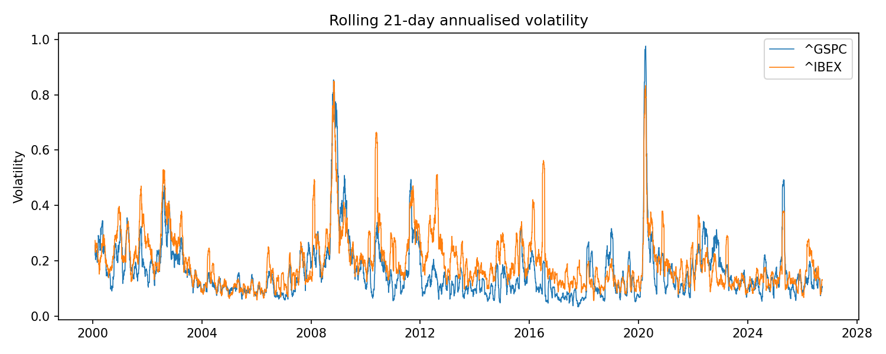
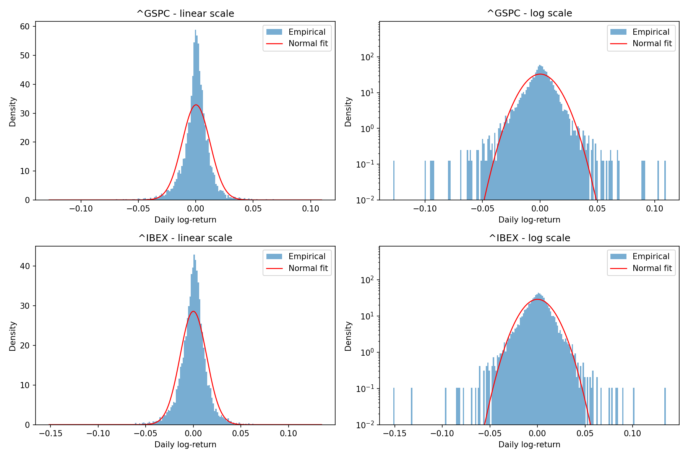
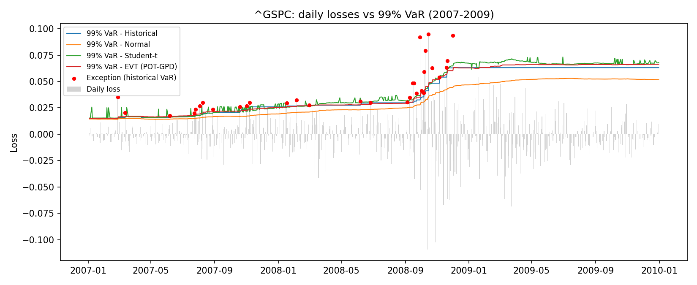
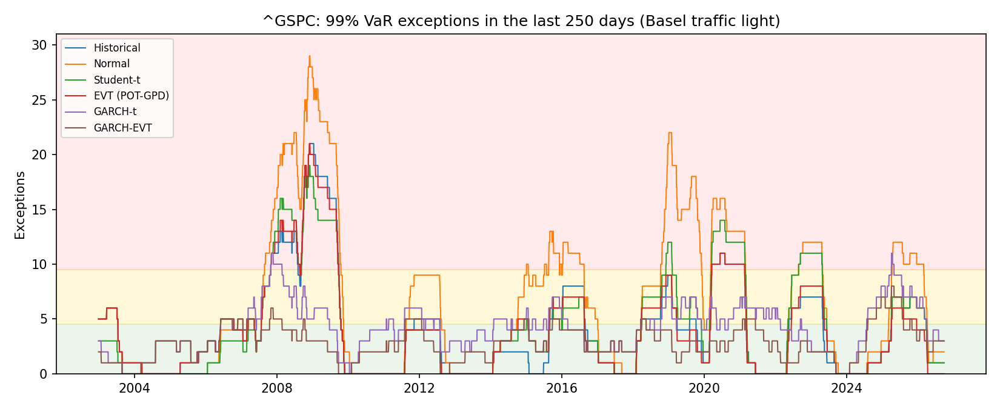
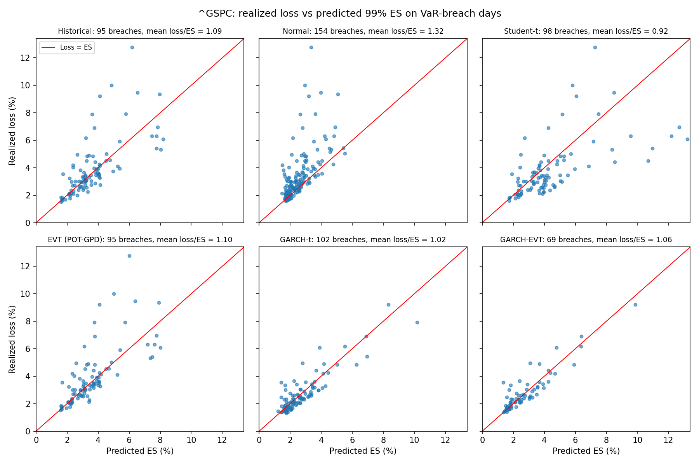
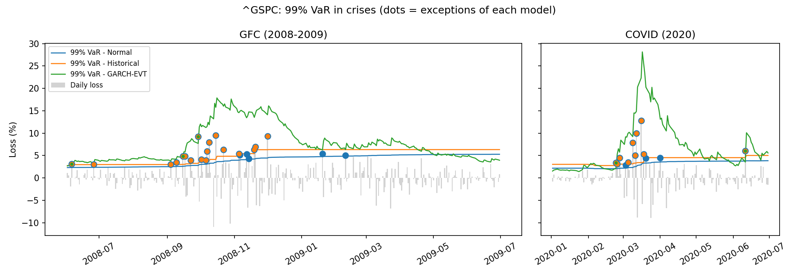

# Empirical Backtesting of VaR and Expected Shortfall

One-day Value-at-Risk (VaR) and Expected Shortfall (ES) models for the
S&P 500 and the IBEX 35 (2000–2026), evaluated with formal
statistical backtests, with a focus on crisis periods (2008, 2020, 2022).

This project is the empirical counterpart of my BSc Mathematics thesis,
*Risk Measures*, where I study risk measures as functionals to understand its properties and proof the ideas behind convex and coherent risk measures.During the thesis, I develop counterexamples to show why VaR is not a coherent risk measure
and Expected Shortfall is. The aim of this project is to test how they behave on real data.

## Summary and findings

- The Gaussian VaR works badly. On the S&P 500 it is breached on 2.5% of days instead of 1%, and it would have been in the Basel red zone 29% of the time.

- Heavier tails bring the number of breaches closer to 1%, but the breaches still come in clusters: without GARCH, the probability of a breach right after another one is around 10%. Adding GARCH brings it down to 3–6%.

- GARCH-filtered EVT is the best model I tested. It passes the Kupiec test on both indices and all three tests on the IBEX 35, and it never enters the Basel red zone between 2002 and 2026. It is not perfect though: on the S&P 500 it still fails the independence test.

## Data

I use daily closing prices from Yahoo Finance for the S&P 500 (`^GSPC`) and the IBEX 35 (`^IBEX`), from January 2000 to September 2026. Both are price indices, so dividends are not included.

## Notation

- Log-returns: $`r_t = \ln(P_t / P_{t-1})`$.
- Losses: $`L_t = -r_t`$.
- A VaR exception on day $`t`$ occurs when $`L_t > \mathrm{VaR}_t`$.

## Risk measures and models

### VaR and Expected Shortfall

Let $`L`$ be the one-day loss, with a continuous distribution, and $`\alpha`$ the confidence level (99% here):

```math
\mathrm{VaR}_\alpha(L) = \inf\{x : P(L \le x) \ge \alpha\} \qquad
\mathrm{ES}_\alpha(L) = \mathbb{E}\left[L \mid L \ge \mathrm{VaR}_\alpha(L)\right]
```

It is a well-known result taht VaR is not a coherent risk measure (Artzner et al., 1999): it fails on sub-additivity, so
diversification may appear to increase risk. However, ES is coherent, and since Basel III (FRTB) it is the regulatory standard at 97.5%.
In the notation of my thesis, $`\mathrm{ES}_{\alpha}(L) = \mathrm{AVaR}_{1-\alpha}(X)`$ for the position $`X = -L`$.

All models produce one-day-ahead forecasts from a rolling 500-day window: the forecast for
day $`t`$ uses only the losses of days $`t-500, \dots, t-1`$.

### Unconditional models

These models treat the 500 losses in the window as i.i.d. draws from a fixed distribution.

**Historical simulation.** VaR is the empirical 99% quantile of
the window, and ES the mean of the losses at or above it.

**Normal.** $`L \sim N(\mu, \sigma^2)`$, with $`\mu, \sigma`$ estimated on the window.
With $`z_\alpha = \Phi^{-1}(\alpha)`$, the risk measures read:

```math
\mathrm{VaR}_\alpha = \mu + \sigma z_\alpha \qquad
\mathrm{ES}_\alpha = \mu + \sigma\,\frac{\varphi(z_\alpha)}{1-\alpha}
```

**Student-t.** $`L = m + s\,T`$ with $`T \sim t_\nu`$, fitted by maximum likelihood.
With $`q = t_\nu^{-1}(\alpha)`$ and $`f_\nu`$ the $`t_\nu`$ density:

```math
\mathrm{VaR}_\alpha = m + s \ q \qquad
\mathrm{ES}_\alpha = m + s \ \frac{f_\nu(q)}{1-\alpha}\cdot\frac{\nu + q^2}{\nu - 1}
```

**Extreme Value Theory.** Instead of fitting the whole distribution, EVT only models the loss tail. By the Pickands–Balkema–de Haan theorem, for most continuous distributions the excesses over a high threshold $`u`$ are close to a Generalized Pareto Distribution:

```math
P(L - u \le y \mid L > u) \approx 1 - \left(1 + \frac{\xi y}{\beta}\right)^{-1/\xi}
```

where $`\xi`$ is the tail index (for instance a Student-t with $`\nu`$ degrees of freedom has $`\xi = 1/\nu`$). With $`u`$ the 90% empirical quantile, $`n`$ observations, $`N_u`$ excesses and $`\xi < 1`$ (Smith, 1987):

```math
\mathrm{VaR}_\alpha = u + \frac{\beta}{\xi}\left[\left(\frac{n}{N_u}(1-\alpha)\right)^{-\xi} - 1\right]
\qquad
\mathrm{ES}_\alpha = \frac{\mathrm{VaR}_\alpha + \beta - \xi u}{1 - \xi}
```

### Conditional models

Unconditional models give the same weight to a loss from 18 months ago as to yesterday's, so
they react slowly when volatility changes. Conditional models let volatility depend on the
recent past.

**GARCH(1,1)** :

```math
L_t = \mu + \sigma_t z_t, \qquad z_t \overset{iid}{\sim} (0,1), \qquad
\sigma_t^2 = \omega + a\varepsilon_{t-1}^2 + b\sigma_{t-1}^2
```

with $`\varepsilon_t = L_t - \mu`$. This is a well-known model that reproduces volatility clustering.
Given the one-day-ahead volatility forecast $`\sigma_{t+1|t}`$:

```math
\mathrm{VaR}_\alpha = \mu + \sigma_{t+1|t}\; q_\alpha(z) \qquad
\mathrm{ES}_\alpha = \mu + \sigma_{t+1|t}\; \mathrm{ES}_\alpha(z)
```

**GARCH-t.** Here, $`z_t`$ follows a Student-t rescaled to unit variance, so $`q_\alpha(z)`$ and
$`\mathrm{ES}_\alpha(z)`$ are the Student-t formulas above multiplied by $`\sqrt{(\nu-2)/\nu}`$.

**GARCH-filtered EVT** (McNeil & Frey, 2000). In this case, the GARCH model is fitted first, and EVT is then
applied to the standardized residuals $`\hat z_t = (L_t - \hat\mu)/\hat\sigma_t`$, which are much
closer to i.i.d. than raw losses.

## Some facts

|                        |        S&P 500      |       IBEX 35       |
|------------------------|---------------------|---------------------|
| Number of observations |        6722         |       6800          |
| Annualized mean        |        6.3%         |       2.0%          |
| Annualized volatility  |       19.2%         |      22.1%          |
| Skewness               |       −0.35         |      −0.32          |
| Excess kurtosis        |       10.7          |       8.2           |
| Worst day              | −12.8% (2020-03-16) | −15.2% (2020-03-12) |
| Best day               | +11.0% (2008-10-13) | +13.5% (2010-05-10) |
| Jarque–Bera p-value    |      < 0.001        |     < 0.001         |

*Returns are log-returns.*

From this statistics, one can already see some of the common facts about financial returns:

- Returns have heavy tails. The worst day of the S&P 500 was a 10.5 $`\sigma`$ move, which under normality would happen about once every $`10^{23}`$ years, and it happened in a sample of 26 years. So a Gaussian VaR is going to underestimate the risk in the tail.

- They are also negatively skewed: large losses are more frequent than large gains of the same size.

- Volatility comes in clusters. The best days of both indices were in the middle of crises (Lehman in 2008, the euro crisis in 2010), and extreme days tend to come together. This is the reason to use GARCH models later on.

- More volatility does not mean fatter tails, though. The IBEX is more volatile, but the S&P 500 has the higher kurtosis.

On the S&P 500, one-month volatility goes from below 10% in 2017 to around 85% in October 2008 and almost 100% during COVID.



On a log scale, the Normal density is almost zero at ±5%, but the data go as far as −15%.



## Rolling VaR forecasts

These are the one-day 99% forecasts with a 500-day rolling window. A correct 99% VaR should be breached on 1% of days.

| Exception rate | S&P 500 | IBEX 35 |
|---|---|---|
| Historical simulation | 1.53% | 1.33% |
| Normal | 2.48% | 1.95% |
| Student-t | 1.58% | 1.49% |
| EVT (POT-GPD, 90% threshold) | 1.53% | 1.19% |
| GARCH-t | 1.64% | 1.49% |
| **GARCH-EVT** | **1.11%** | **1.10%** |

*S&P 500: 6,222 forecasts (2002–2026). IBEX 35: 6,300 forecasts (2002–2026).*

GARCH-EVT is the only model close to 1% on both indices.

The Gaussian VaR is breached 2.5 times more often than it should on the S&P 500, which is what one would expect given the fat tails.

Better tails are not enough, though. The Student-t beats the Normal but not historical simulation. Adding GARCH is not enough either: GARCH-t stays at around 1.5–1.6%. It is the combination of GARCH and EVT that gets close to 1%.

The Student-t is also symmetric while returns are negatively skewed, which is probably why it does worse than historical simulation on the IBEX. EVT only looks at the loss tail and is the best unconditional model there (1.19%).

On the S&P 500, EVT and historical simulation have the same exception rate. At 99% with 500 days the quantile is still inside the data, so EVT has little to extrapolate. It should help more further out in the tail, but I did not test that here.



*The unconditional models (historical, Normal, Student-t and EVT) underestimated risk going into 2008, were breached in clusters during the crisis, and then stayed too conservative for two years while the crisis days were still in the window. The GARCH models react within days, both up and down. Red dots are the exceptions of historical simulation.*

## Formal backtests

### Methodology

Let $`I_t = \mathbf{1}_{\{L_t > \mathrm{VaR}_t\}}`$ be the sequence of exceptions. If a VaR model at confidence level $`\alpha`$ is correct, $`I_t`$ must satisfy two properties (Christoffersen, 1998):

1. Unconditional coverage: $`P(I_t = 1) = p`$, with $`p = 1 - \alpha`$.
2. Independence: $`I_t`$ is independent of $`I_{t-1}, I_{t-2}, \dots`$, so exceptions do not cluster in time.

Together, they mean that $`I_t \overset{iid}{\sim} \mathrm{Bernoulli}(p)`$.

#### Kupiec (1995): proportion-of-failures test

With $`x`$ exceptions in $`n`$ days and observed rate $`\hat\pi = x/n`$, the test compares

```math
H_0: P(I_t = 1) = p \qquad \text{vs.} \qquad H_1: P(I_t = 1) \neq p
```

through the likelihood ratio of two binomial models:

```math
LR_{uc} = -2 \ln \frac{(1-p)^{n-x} p^{x}}{(1-\hat\pi)^{n-x} \hat\pi^{x}} \overset{H_0}{\sim} \chi^2_1
```

The test is two-sided: it rejects models with too many exceptions, but also models with too few, which are too conservative and tie up capital for nothing. The problem is that it only counts exceptions and does not look at when they happen.

#### Christoffersen (1998): independence and conditional coverage

Here $`I_t`$ is modelled as a first-order Markov chain. Let $`n_{ij}`$ be the number of days with $`I_{t-1} = i`$ and $`I_t = j`$, and define

```math
\pi_{01} = \frac{n_{01}}{n_{00} + n_{01}}, \qquad
\pi_{11} = \frac{n_{11}}{n_{10} + n_{11}}, \qquad
\pi = \frac{n_{01} + n_{11}}{n_{00} + n_{01} + n_{10} + n_{11}}
```

where $`\pi_{01}`$ is the probability of an exception after a normal day and $`\pi_{11}`$ the
probability of an exception right after another exception. Under independence,
$`\pi_{01} = \pi_{11} = \pi`$:

```math
LR_{ind} = -2 \ln \frac{(1-\pi)^{n_{00}+n_{10}} \pi^{n_{01}+n_{11}}}
{(1-\pi_{01})^{n_{00}} \pi_{01}^{n_{01}} (1-\pi_{11})^{n_{10}} \pi_{11}^{n_{11}}}
\overset{H_0}{\sim} \chi^2_1
```

The conditional coverage test checks both properties at once:

```math
LR_{cc} = LR_{uc} + LR_{ind} \overset{H_0}{\sim} \chi^2_2
```

A model can pass Kupiec and still fail this test, if the right number of exceptions all happen
during the same crisis.

#### Basel traffic light

Banking supervisors count the 99% VaR exceptions over the last 250 trading days
(Basel Committee on Banking Supervision, 1996):

| Zone | Exceptions in 250 days | Capital multiplier |
|---|---|---|
| Green | 0–4 | 3 |
| Yellow | 5–9 | 3.40 – 3.85 |
| Red | 10 or more | 4 (model under review) |

Market-risk capital is roughly the multiplier times the average VaR, so moving into the yellow or red zone costs the bank capital.

#### Acerbi & Szekely (2014): Expected Shortfall backtest

ES is harder to backtest than VaR because it is not elicitable (Gneiting, 2011), and for a while it was thought that it could not be backtested at all. Acerbi and Szekely showed that it can, using an identity that holds for a correct model:

```math
\mathbb{E}\left[L_t\, I_t\right] = p \cdot \mathrm{ES}_t
```

They use two statistics, both with zero expectation under $`H_0`$ and negative when the tail risk is underestimated:

```math
Z_1 = 1 - \frac{1}{N}\sum_{t:\,I_t=1} \frac{L_t}{\mathrm{ES}_t}
\qquad
Z_2 = 1 - \frac{1}{T}\sum_{t=1}^{T} \frac{L_t\, I_t}{p\,\mathrm{ES}_t}
```

$`Z_1`$ looks at the size of the losses on exception days ($`N`$ is the number of exceptions), and $`Z_2`$ looks at their frequency and size together. For the p-value of $`Z_2`$ I use a CLT approximation, $`Z_2 \sqrt{T} / \hat s \approx N(0,1)`$, with $`\hat s`$ the standard deviation of $`L_t I_t / (p\,\mathrm{ES}_t)`$.

### Results

| | S&P 500 | | | IBEX 35 | | |
|---|---|---|---|---|---|---|
| **Model** | **Kupiec p** | **Indep. p** | **Time in red** | **Kupiec p** | **Indep. p** | **Time in red** |
| Historical | <0.001 | <0.001 | 11.6% | 0.011 | <0.001 | 8.0% |
| Normal | <0.001 | <0.001 | 29.1% | <0.001 | <0.001 | 14.5% |
| Student-t | <0.001 | <0.001 | 15.3% | <0.001 | <0.001 | 8.0% |
| EVT (POT-GPD) | <0.001 | <0.001 | 11.8% | 0.14 | <0.001 | 5.5% |
| GARCH-t | <0.001 | 0.12 | 1.6% | <0.001 | 0.068 | 2.3% |
| **GARCH-EVT** | **0.40** | 0.008 | **0%** | **0.45** | **0.23** | **0%** |

*Kupiec: correct number of exceptions. Independence: Christoffersen (1998).
Time in red: share of days with 10+ exceptions in the last 250 days (Basel).*

**Expected Shortfall backtest (Acerbi–Szekely $`Z_2`$)**

| | S&P 500 | | IBEX 35 | |
|---|---|---|---|---|
| **Model** | **Loss / ES on breach days** | **$`Z_2`$ p-value** | **Loss / ES on breach days** | **$`Z_2`$ p-value** |
| Historical | 1.09 | <0.001 | 1.07 | 0.006 |
| Normal | **1.32** | <0.001 | **1.30** | <0.001 |
| Student-t | 0.92 | 0.002 | 1.12 | <0.001 |
| EVT (POT-GPD) | 1.10 | <0.001 | 1.14 | 0.018 |
| GARCH-t | 1.02 | <0.001 | 1.09 | <0.001 |
| **GARCH-EVT** | 1.06 | **0.115** | 1.10 | **0.092** |

*Loss / ES = average realized loss on VaR-breach days divided by the predicted ES (1 if correct).*

With an equally weighted 500-day window, the probability of a breach right after another breach goes from around 1.5% to around 10%, whatever the distribution. That is why the unconditional models fail the independence test.

GARCH helps a lot here: that probability falls to 3–6%, and GARCH-t passes the independence test on both indices. But GARCH-t still has too many breaches (1.5–1.6%), probably because its loss tail is too thin.

So you need both. GARCH-EVT is the only model that passes the Kupiec test on both indices and the only one that never enters the Basel red zone, against 29% of days for the Gaussian VaR on the S&P 500. On the IBEX it passes all the tests. On the S&P 500 it fails independence, although this rests on only four pairs of consecutive breaches.

As for the ES, the size of the losses is mostly right and the problem is the frequency. On breach days, realized losses are within 14% of the predicted ES for every model except the Normal, whose realized losses are about 30% above its prediction. So most $`Z_2`$ rejections come from having too many exceptions. GARCH-EVT is the only model whose ES is not rejected on either index at 5%, though the p-values are not large (0.115 and 0.092).




*Each point is a day with a VaR breach. If the ES forecast is correct, the points should scatter around the red line. The unconditional models react slowly, so in a crisis the losses end up far above their ES. For GARCH-EVT the ES rises with volatility and the points stay close to the line.*

## Crisis analysis and final results

### Exceptions in crisis periods (99% VaR, observed / expected)

| S&P 500 | Historical | Normal | Student-t | EVT | GARCH-t | GARCH-EVT |
|---|---|---|---|---|---|---|
| GFC (Sep 2008 – Jun 2009) | 16 / 2.1 | 21 / 2.1 | 14 / 2.1 | 15 / 2.1 | 4 / 2.1 | 2 / 2.1 |
| Euro crisis (H2 2011) | 5 / 1.3 | 9 / 1.3 | 4 / 1.3 | 4 / 1.3 | 3 / 1.3 | 2 / 1.3 |
| COVID (Feb – Jun 2020) | 10 / 0.9 | 13 / 0.9 | 12 / 0.9 | 10 / 0.9 | 3 / 0.9 | 2 / 0.9 |
| Rate hikes (2022) | 7 / 2.5 | 12 / 2.5 | 11 / 2.5 | 8 / 2.5 | 3 / 2.5 | 2 / 2.5 |
| Calm year (2017) | 0 / 2.5 | 0 / 2.5 | 0 / 2.5 | 0 / 2.5 | 2 / 2.5 | 2 / 2.5 |

| IBEX 35 | Historical | Normal | Student-t | EVT | GARCH-t | GARCH-EVT |
|---|---|---|---|---|---|---|
| GFC (Sep 2008 – Jun 2009) | 10 / 2.1 | 14 / 2.1 | 9 / 2.1 | 8 / 2.1 | 1 / 2.1 | 0 / 2.1 |
| Euro crisis (H2 2011) | 3 / 1.3 | 7 / 1.3 | 5 / 1.3 | 4 / 1.3 | 1 / 1.3 | 1 / 1.3 |
| COVID (Feb – Jun 2020) | 13 / 0.9 | 16 / 0.9 | 16 / 0.9 | 11 / 0.9 | 5 / 0.9 | 3 / 0.9 |
| Rate hikes (2022) | 3 / 2.6 | 4 / 2.6 | 2 / 2.6 | 2 / 2.6 | 5 / 2.6 | 5 / 2.6 |
| Calm year (2017) | 0 / 2.5 | 0 / 2.5 | 0 / 2.5 | 0 / 2.5 | 1 / 2.5 | 1 / 2.5 |



During the 2008 crisis and COVID, the unconditional models have between 4 and 18 times more breaches than expected. GARCH-EVT has 2 on the S&P 500 and 0 on the IBEX in 2008 (2.1 expected), and 2 and 3 in COVID (0.9 expected).

In calm periods the unconditional models are too conservative: they have no breaches at all in 2017, because the 500-day window still contains the volatility of 2015 and 2016.

GARCH is not perfect either. The first days of COVID still caught it out, and on the IBEX it has 5 breaches in 2022 against 2.6 expected, three of them between 24 February and 3 March, when the war in Ukraine started. It also overreacts after a big shock: on the S&P 500 its VaR reached 28% in March 2020, more than twice the worst daily loss in the whole sample.

### Basel capital charge

Market-risk capital under the Basel internal-models approach, using the one-day VaR instead of the regulatory 10-day one and without the stressed-VaR add-on:

```math
\text{capital}_t = \max\left(\mathrm{VaR}_t,\; m_t \cdot \overline{\mathrm{VaR}}_{t,\,60\text{d}}\right)
```

where $`m_t \in [3, 4]`$ is the traffic-light multiplier.

| Model | Tests passed (S&P / IBEX) | Avg. capital S&P 500 | Avg. capital IBEX 35 |
|---|---|---|---|
| Historical | 0/3 · 0/3 | 10.36% | 10.93% |
| Normal | 0/3 · 0/3 | 8.88% | 10.11% |
| Student-t | 0/3 · 0/3 | 10.61% | 11.18% |
| EVT (POT-GPD) | 0/3 · 1/3 | 10.62% | 11.43% |
| GARCH-t | 1/3 · 1/3 | 8.19% | 9.65% |
| **GARCH-EVT** | **2/3 · 3/3** | **8.72%** | **10.24%** |

*Tests: Kupiec, Christoffersen independence and Acerbi–Szekely Z2, at 5%.*

GARCH-EVT needs 16% less capital on average than historical simulation on the S&P 500 (6% on the IBEX) and passes more tests, because it raises VaR in crises and lowers it in calm periods.

The price is that its capital jumps when things go badly. It peaks at 43% on the S&P 500 and 37% on the IBEX, against 25% and 21% for historical simulation.

The Normal model has the lowest average VaR among the unconditional models, but it spends so much time in the red zone (multiplier 4) that on the S&P 500 it ends up needing more capital than GARCH-EVT.

## Project structure

```
src/varbacktest/   library code (data, models, forecast engine, backtests)
tests/             unit tests (pytest)
scripts/           analysis scripts that produce tables and figures
results/           rolling forecasts and backtest tables (CSV)
figures/           generated charts
data/              local price cache (not tracked by git)
```

## How to run

```bash
python -m venv .venv
source .venv/bin/activate
pip install -r requirements.txt
pip install -e .

python scripts/01_explore_data.py   # statistics and figures of the returns
python scripts/02_rolling_var.py    # rolling forecasts and exception counts
python scripts/03_backtests.py      # VaR and ES backtests
python scripts/04_crisis.py         # crisis tables, capital and final scorecard
pytest                              # tests
```

The prices are not in the repo: the first run downloads them from Yahoo up to today, so the table of statistics can change a little. The rolling forecasts used in this README are saved in `results/`, and the scripts reuse them because fitting everything again takes a long time.
